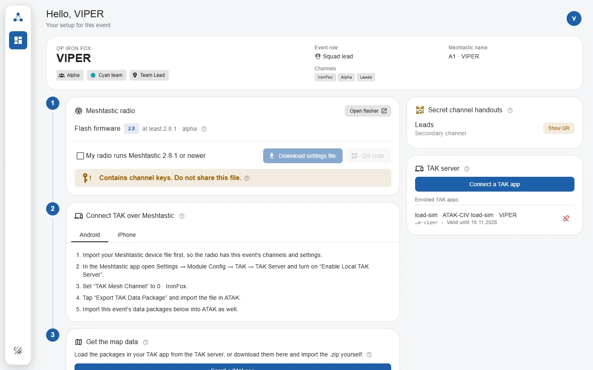
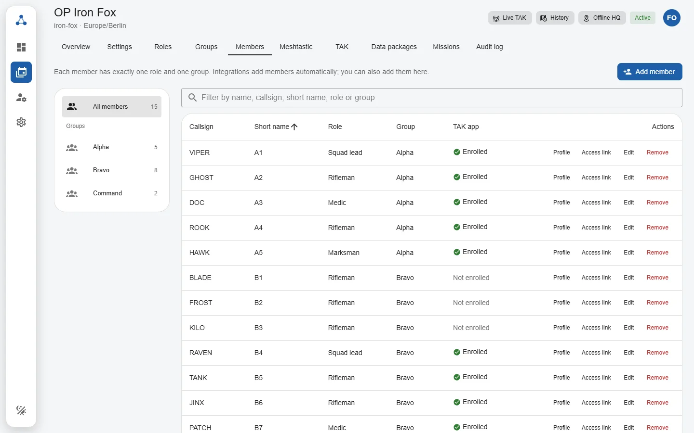
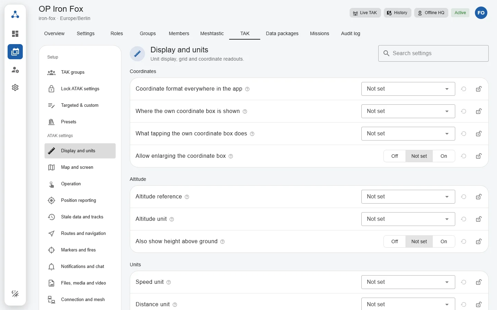
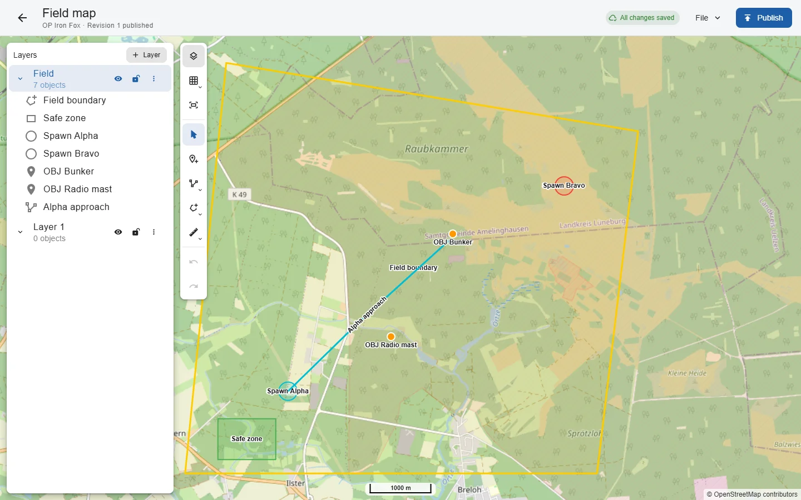

# OpenMeshTak Web

**The Web app of OpenMeshTak, the self-hosted TAK server with Meshtastic for events.** Administrators set up events, roles, groups, TAK and Meshtastic settings and map data; participants connect ATAK, iTAK, WinTAK and their Meshtastic radio from their own dashboard.

[](LICENSE) [](https://github.com/OpenMeshTAK/openmeshtak-web/actions/workflows/ci.yml)

**[Documentation](https://openmeshtak.github.io/openmeshtak-docs/)** · [Install with Docker](https://openmeshtak.github.io/openmeshtak-docs/installation/) · [Self-hosted TAK server](https://openmeshtak.github.io/openmeshtak-docs/tak-server) · [ATAK with Meshtastic](https://openmeshtak.github.io/openmeshtak-docs/atak-meshtastic)

The Web app ships inside the [OpenMeshTak Core](https://github.com/OpenMeshTAK/openmeshtak) Docker image; you do not install it separately.

<picture>
  <source media="(prefers-color-scheme: dark)" srcset=".github/readme/participant-home-dark.webp">
  
</picture>

<table>
  <tr>
    <td width="33%">
      <picture>
        <source media="(prefers-color-scheme: dark)" srcset=".github/readme/event-members-dark.webp">
        
      </picture>
      <p align="center">Members, roles and groups</p>
    </td>
    <td width="33%">
      <picture>
        <source media="(prefers-color-scheme: dark)" srcset=".github/readme/atak-settings-dark.webp">
        
      </picture>
      <p align="center">ATAK settings per event</p>
    </td>
    <td width="33%">
      <picture>
        <source media="(prefers-color-scheme: dark)" srcset=".github/readme/package-editor-dark.webp">
        
      </picture>
      <p align="center">Map data for TAK apps</p>
    </td>
  </tr>
</table>

The screenshots show a fictional demo event.

## About this repository

OpenMeshTak Web is the dashboard-first PWA for participants, administrators and mission editors. It is a client of the OpenMeshTak Core API and contains no authorization, profile-resolution, format-conversion or package-generation rules of its own.

OpenMeshTak is under active development. Provisioning actions rely on Core's tested delivery-capability data and must not be interpreted as unverified TAK, iTAK or Meshtastic compatibility claims.

## Capabilities

- focused participant dashboard for active events and provisioning artifacts
- first-run setup, account security, passkeys and participant claims
- event, member, group, role, permission and API-client administration
- TAK server, base-map, email and Meshtastic configuration
- channel audience, key-holder and secret-handout workflows
- ATAK-focused mission map editing and Data Package composition
- read-only live TAK traffic view for authorized users
- responsive Vue PWA for desktop, tablet and focused phone workflows

## Requirements

- Node.js 24 or newer
- pnpm 10.12 or newer
- a running OpenMeshTak Core for local development

## Local development

Start Core with `PUBLIC_ORIGIN=http://localhost:5173`, then:

```sh
pnpm install
pnpm dev
```

Vite serves the app on `http://localhost:5173` and proxies `/api` to Core
(`http://127.0.0.1:3000`, override with `OPENMESHTAK_CORE_URL`), so the browser stays same-origin
like the production deployment.

## API contract

`openapi/openapi.json` is a committed copy of Core's contract and `src/generated/api` is generated
from it. After Core changes its API:

```sh
pnpm api:sync      # copy ../openmeshtak/openapi/openapi.json
pnpm api:generate  # regenerate the typed client
```

## Verification

```sh
pnpm check
```

Create a production build with:

```sh
pnpm build
```

The production Web application is served by Core on the same origin as the API. The Core Docker build consumes this repository through its `web` build context.

## AI assistance

LLMs are used in the development of this project. See [AI_USAGE.md](AI_USAGE.md) for how they are used and reviewed.

## License

OpenMeshTak Web is licensed under `AGPL-3.0-only`.
